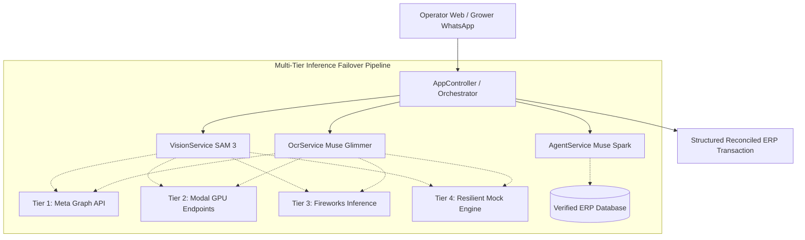

# AgroControl Multimodal (`agrocontrol-meta-ia-engine`)

> **Meta Global AI Developer Hackathon — Startup Track**  
> **Target Problem:** Automating the "Analog Mile" in B2B Agricultural Reception Yards via Multimodal Meta AI & Agentic Workflows.

---

## 📋 Evaluation Criteria & Technical Architecture Mapping

| Evaluation Criteria | Track Focus | Architectural Component | Implementation & Business Value |
| :--- | :--- | :--- | :--- |
| **1. Impact** | **30%** | [`app.controller.ts`](file://src/app.controller.ts) (`POST /api/reception/process`) | Eliminates manual clipboard tallying at crop reception yards. Executes concurrent `Promise.all` across vision and OCR pipelines, automatically cross-referencing physical bins vs declared guide to grant immediate ERP intake approval. |
| **2. Use of Meta AI Tooling** | **25%** | [`vision.service.ts`](file://src/ai/services/vision.service.ts) & [`ocr.service.ts`](file://src/ai/services/ocr.service.ts) | Applied to physical-world agricultural supply chain friction. Uses **SAM 3** to segment stacked wooden bins and **Muse Glimmer** to parse dirty, handwritten field dispatch guides. |
| **3. Open-Weight Models** | **Special Category** | Modal & Fireworks Routing | Explicit serverless endpoints hosted on **Modal** GPU containers and **Fireworks Serverless Inference** running Meta open-weight model checkpoints. |
| **4. Technical Depth & Execution** | **20%** | [`ConfigModule`](file://src/config/configuration.ts) & Fallback Engine | Multi-tier failover circuit breaker (`Meta -> Modal -> Fireworks -> Mock`). Zero-downtime during live demos, RFC-compliant error filters, correlation `requestId` UUIDs, and strict TypeScript. |
| **5. Demo Presentation** | **25%** | [`public/index.html`](file:///home/daniel/projects/agrocontrol-meta-ia-engine/public/index.html) Split-Screen UI | Clean, corporate Light-Mode B2B SaaS dashboard built with Tailwind CSS. Screen A (Yard Operator Intake) and Screen B (Grower WhatsApp Portal) delivering a seamless 3-minute physical-to-digital demonstration. |
| **6. Agentic Workflow** | **Special Category** | [`agent.service.ts`](file://src/ai/services/agent.service.ts) (Muse Spark) | Autonomous decision-making agent. Injects ERP context via RAG, evaluates payment status, validates historical records, and resolves grower inquiries without human triage. |

---

## 🌾 The Problem: The "Analog Mile" in Agricultural Reception
In harvest seasons (cherries, apples, table grapes), fruit packing plants receive hundreds of flatbed trucks daily.
- **Physical Discrepancies:** Yard operators manually tally 15–40 stacked wooden bins per truck. Discrepancies cause billing delays and grower mistrust.
- **Handwritten Dispatches:** Farmers deliver handwritten dispatch guides (*Guías de Despacho de Campo*) filled out with pens in adverse field conditions (dirt, dust, water), resulting in re-keying errors in ERPs.
- **Support Overload:** Farmers wait days without visibility into batch acceptance or liquidation statuses, overwhelming plant telephone lines.

**AgroControl Multimodal** replaces manual paperwork with a sub-second multimodal reconciliation engine:
1. **Automated Visual Counting (SAM 3):** Segments and counts fruit bins on incoming flatbed trucks.
2. **Dirty Document Extraction (Muse Glimmer):** Digitizes wrinkled, handwritten field guides into structured JSON.
3. **Conversational Financial Agent (Muse Spark):** Natural language Q&A for farmers grounded in real ERP delivery and liquidation records.

---

## ⚡ Architecture & Tech Stack



- **Backend:** Node.js v20+, NestJS v11, TypeScript (strict mode)
- **Security & Standards:** `helmet`, `@nestjs/throttler`, global `AllExceptionsFilter` with UUID correlation IDs.
- **Documentation:** Interactive OpenAPI / Swagger at `/api/docs`.
- **Frontend Demo:** Static, zero-build `index.html` styled with Tailwind CSS (clean B2B light mode, enterprise forest green branding, and authentic WhatsApp Web portal).
- **Deployment Target:** Azure App Service.

---

## 🚀 Quick Start

### 1. Installation
```bash
npm install
```

### 2. Configure Environment Variables
```bash
cp .env.example .env
```
Fill in your Meta Graph API, Modal, or Fireworks API keys. If keys are unpopulated, the engine automatically uses Tier 4 Local Mock Fallback to guarantee a flawless demo.

### 3. Build & Run
```bash
# Run unit tests (7/7 passing across all modules)
npm test

# Build production bundle
npm run build

# Start local dev server with hot-reload
npm run start:dev
```

### 4. Interactive URLs
- **Live Demo Dashboard:** [http://localhost:3000/](http://localhost:3000/)
- **Swagger OpenAPI Documentation:** [http://localhost:3000/api/docs](http://localhost:3000/api/docs)
- **Health Diagnostic Endpoint:** [http://localhost:3000/api/health](http://localhost:3000/api/health)

---

## 📄 License & Attribution
Developed by **Daniel Fuentes Busco** (Founder, **Atelier Busco SpA**) for the **Meta Global AI Developer Hackathon**.
Licensed under UNLICENSED / Proprietary.
