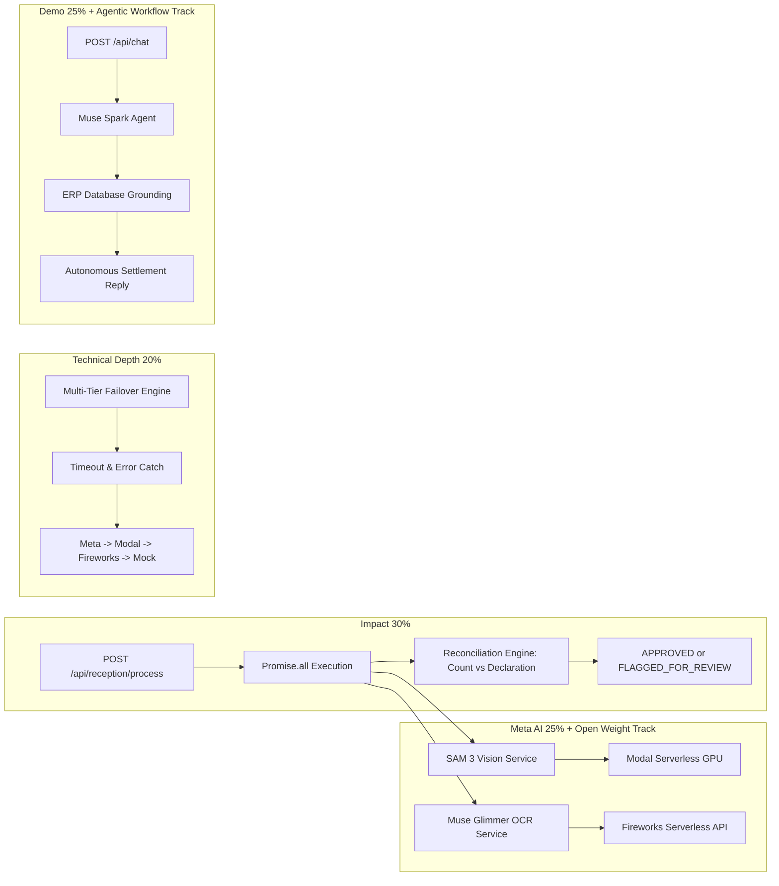

# Technical Specification: AgroControl Multimodal Engine

## Meta Global AI Developer Hackathon Alignment

---

## 1. Impact (30%): Master Orchestrator Architecture
- **Location:** [`src/app.controller.ts`](file://src/app.controller.ts) & [`src/reception/reception.service.ts`](file://src/reception/reception.service.ts)
- **Primary Endpoint:** `POST /api/reception/process` (alias: `POST /api/process-reception`)
- **Execution:** Runs `VisionService` and `OcrService` in parallel with `Promise.all`.
- **Reconciliation Logic:**
  - Evaluates `visionResult.totalBins` against `ocrResult.declaredBins`.
  - Exact match (`differenceBins === 0`) produces status `APPROVED`.
  - Discrepancy (`differenceBins !== 0`) produces status `FLAGGED_FOR_REVIEW`.
  - Injects transaction into `MockDbService` for real-time ERP traceability.

---

## 2. Meta AI Tooling (25%) & Open-Weight Deployment
- **SAM 3 (`VisionService`):**
  - Targets physical wooden fruit bins and pallets on flatbed trucks arriving at packing plants.
  - Endpoints configured to route to **Modal Serverless GPU Endpoints** running open-weight Meta checkpoints.
- **Muse Glimmer (`OcrService`):**
  - Targets distorted, wrinkled, dirty field dispatch guides with handwritten ballpoint ink.
  - Endpoints configured to route to **Fireworks Serverless Inference** for open-weight multimodal parsing.

---

## 3. Technical Depth & Execution (20%): Failover Architecture
- **Location:** [`src/config/configuration.ts`](file://src/config/configuration.ts) and AI services.
- **Failover Sequence:**
  1. Primary Provider (e.g. `meta`)
  2. Fallback Tier 1 (`modal`)
  3. Fallback Tier 2 (`fireworks`)
  4. Fallback Tier 3 (`mock` local engine for fail-safe resilience)
- **Correlation & Observability:**
  - `AllExceptionsFilter` attaches unique UUID `x-request-id` to every error.
  - `LoggingInterceptor` calculates processing latency in milliseconds.
  - `@nestjs/throttler` protects API endpoints (100 req/min).
  - `helmet` secures all HTTP response headers.

---

## 4. Demo (25%) & Autonomous Agentic Workflow
- **Agent Service (`Muse Spark`):**
  - Located in [`src/ai/services/agent.service.ts`](file://src/ai/services/agent.service.ts).
  - Autonomous evaluation: Inspects verified delivery history from `MockDbService`, assesses settlement (`isLiquidated`), verifies dates, computes payout totals, and answers in natural Chilean agricultural Spanish.
- **Split-Screen Demo UI:**
  - Located in [`public/index.html`](file://src/public/index.html) and served by NestJS.
  - Left screen: Yard operator live intake with 1-click test scenarios.
  - Right screen: Grower WhatsApp portal with real-time conversational assistance.
