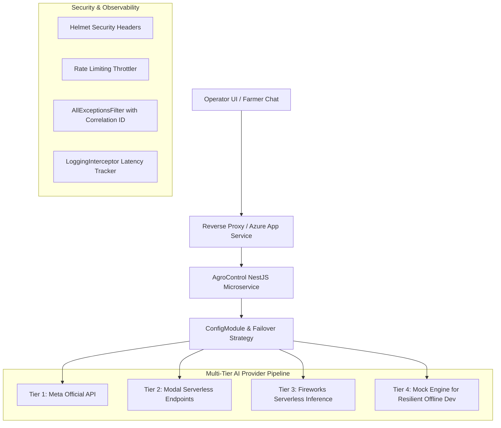

# Technical Specification: AgroControl Multimodal Engine

## Architecture Overview
The system is built as an enterprise-grade NestJS microservice targeting deployment on Azure App Service.



---

## Data Contracts & Interfaces

### 1. Vision Service (`SAM 3`)
- **Input:** `imageUrl` (string) or base64 encoded image string.
- **Output:**
```typescript
interface VisionAnalysisResult {
  totalBins: number;
  totalPallets: number;
  confidenceScore: number;
  processingTimeMs: number;
  provider: string;
}
```

### 2. OCR Service (`Muse Glimmer`)
- **Input:** `imageUrl` (string) or base64 encoded handwritten guide image.
- **Output:**
```typescript
interface DocumentExtractionResult {
  documentId: string;
  supplierRut: string;
  declaredKilos: number;
  declaredBins: number;
  cropType: string;
  isLegible: boolean;
  confidenceScore: number;
  processingTimeMs: number;
  provider: string;
}
```

### 3. Agentic Conversational Service (`Muse Spark`)
- **Input:** `{ farmerId: string; userMessage: string; }`
- **Output:**
```typescript
interface AgentChatResult {
  agentResponse: string;
  intent: 'PAYMENT_STATUS' | 'DELIVERY_CONFIRMATION' | 'QUALITY_DISPUTE' | 'GENERAL_INQUIRY';
  groundedDeliveriesCount: number;
  provider: string;
}
```

### 4. Reception Reconciliation Orchestrator (`POST /api/reception/process`)
- **Input:** `{ truckImage: string; dispatchGuideImage: string; yardId: string; }`
- **Logic:** Runs Vision Service and OCR Service concurrently (`Promise.all`), compares `totalBins` with `declaredBins`.
- **Status Outcome:**
  - `APPROVED` if `totalBins === declaredBins`.
  - `FLAGGED_FOR_REVIEW` if `totalBins !== declaredBins`.
